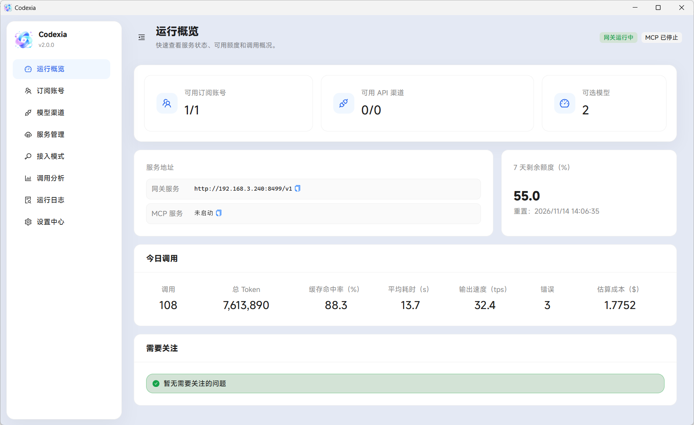

# Codexia

[中文文档](README_zh.md)

Codexia is a Windows desktop app for using ChatGPT subscription accounts, the official OpenAI API, and third-party model channels from Codex.



## Features

- Manage subscription pools and model channels through a local Responses API service.
- View account quota, request analytics, and estimated costs.
- Manage Codex integration and an optional [MCP service](https://github.com/jadchene/mcp-gateway).

## Quick Start

1. Install Codex CLI and confirm that the `codex` command is available.
2. Extract the Windows portable build into a writable directory and open `Codexia.exe`.
3. Add an account or model channel. Accounts support browser login and Codex import. Official OpenAI channels need only an API key; third-party channels need an API address, API key, and model catalog.
4. Choose a mode and connection options under **Integration Mode**, review the configuration preview, and apply it to Codex. For Gateway mode, start the gateway under **Services**. Applying another mode with proxying enabled starts the gateway automatically.
5. Restart Codex after applying, or enable automatic app-server restart for the selected mode. This requires a Codex version that supports `codex app-server daemon restart`. If restart fails after configuration is applied, the configuration remains saved; restart Codex manually.

## Choosing an Integration Mode

| Mode | Account or channel | Gateway proxy | Models with catalog enabled |
| --- | --- | --- | --- |
| Gateway | Subscription pool and enabled API channels | Always enabled | Combined pool and channel models |
| Account | One selected ChatGPT subscription account | Optional, off by default | Subscription models using the pool's model settings |
| OpenAI API | One selected OpenAI channel | Optional, off by default | Models from the selected OpenAI channel |
| Third-party API | One selected third-party channel | Required | Available models from the selected channel only |

Model catalogs are enabled by default, with separate preferences for Gateway, Account, and OpenAI API modes. Disabling a catalog uses Codex's default model catalog. Third-party mode only displays and accepts available models from the selected channel, for both HTTP and WebSocket requests.

Keep Codexia and its gateway running when using Gateway mode or proxying. Direct connections in Account and OpenAI API modes bypass Codexia and do not create Codexia request logs. Proxying in non-gateway modes uses the selected account or channel without account rotation, channel fallback, quota rewriting, or compaction adaptation.

## Configuration Changes and Previews

All four modes preview `config.toml` changes. Gateway and API modes also show a masked `auth.json` preview. Previews show managed fields and removal notes, not the entire file; masked API keys are not usable credentials.

- Connecting through the local gateway writes `openai_base_url`. Disabling proxying in Account or OpenAI API mode removes it.
- Enabling the model catalog writes `model_catalog_json`; disabling it removes that field. Third-party mode requires it.
- Applying a mode removes the previous top-level `model_provider` and Codexia-managed provider definitions, preserving other channel definitions, MCP settings, and unrelated configuration.
- In API modes, `# codexia_channel = "…"` is a comment identifying the selected channel. It is not a Codex setting and does not control request routing.

Configuration defaults to the current user's `.codex` directory; set `CODEX_HOME` to use another location. Invalid TOML or a top-level `profile` selection that could override connection settings prevents applying a mode. Fix the syntax or remove the top-level profile selection first; profile definitions can remain.

## Usage Notes

- In Gateway mode, shared model IDs prefer the enabled subscription pool; disable the pool to use OpenAI API. A channel's gateway routing switch only affects Gateway mode.
- Codexia reads the active subscription account's tokens from Codex's `auth.json`; Codex handles token refresh.
- Third-party model IDs must be unique across channels and the built-in catalog. Configure model rates per channel; estimates do not represent actual bills.
- In Gateway mode, other Responses API clients can use `http://localhost:8436/v1` with the local access key from Settings.

## Data and Upgrades

Data lives in `data/` beside the executable. Preserve this directory during upgrades and close the app before backup. Credentials use Windows encryption; moving to another user or machine may require signing in again.

Upgrading does not automatically reapply integration settings. If an older configuration still contains a Codexia provider, review the options under Integration Mode, apply them again, and restart Codex.

Monitoring logs may be incomplete if storage fails or the write queue fills up. Request forwarding continues, so use provider records for billing reconciliation.

API debugging temporarily records request and response bodies, which may contain sensitive data. Enable it only for troubleshooting.

## Development

Node.js 24 or newer is required.

```bash
npm install
npm run dev
npm run verify
npm run pack:unpacked
```

The package output is `release/win-unpacked/Codexia.exe`. It is not code-signed.

## License

MIT. See [LICENSE](LICENSE).
