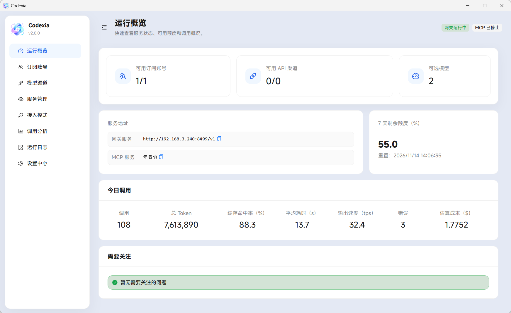

# Codexia

[English README](README.md)

Codexia 是一个 Windows 桌面应用，用于在 Codex 中集中使用 ChatGPT 订阅账号、OpenAI 官方 API 和第三方模型渠道。



## 功能

- 管理订阅账号池和模型渠道，提供本地 Responses API 服务。
- 查看账号额度、调用统计和预估成本。
- 管理 Codex 接入配置和可选的 [MCP 服务](https://github.com/jadchene/mcp-gateway)。

## 快速开始

1. 安装 Codex CLI，确认 `codex` 命令可用。
2. 将 Windows 免安装包解压到可写目录，打开 `Codexia.exe`。
3. 添加订阅账号或模型渠道：账号支持浏览器登录和 Codex 导入；OpenAI 官方渠道只需 API Key；第三方渠道需填写 API 地址、API Key 和模型目录。
4. 在“接入模式”选择模式并应用到 Codex。使用网关模式时，在“服务管理”启动网关服务。
5. 按需启用各模式的“自动重启 appserver”，应用配置后执行 `codex app-server daemon restart`；关闭时请手动重启 Codex。

## 使用要点

- **网关模式**汇集账号池和模型渠道。同名模型优先走已启用的账号池；使用官方 API 时可停用账号池。
- **账号模式**使用选定的订阅账号，支持账号池模型列表覆盖，不包含第三方渠道模型。生效账号的 token 从 Codex 的 `auth.json` 同步，由 Codex 负责刷新。
- **OpenAI 官方 API 模式 / 第三方 API 模式**分别选择对应类型的单独渠道，直接使用其密钥、连接配置和模型目录，渠道开关仅影响网关模式。
- 三种非网关模式均可启用网关代理监控：保留请求与响应业务参数、凭据和错误信息，不做账号轮换、渠道回退、额度改写或压缩适配。维护必要的连接状态并记录日志。
- 第三方模型 ID 不能与其他渠道或内置模型重复。模型费率可在渠道中配置，预估成本不代表实际账单。
- 其他 Responses API 客户端可使用 `http://localhost:8436/v1` 和设置中的本地访问密钥。
- Codex 配置默认位于当前用户的 `.codex`，也可通过 `CODEX_HOME` 指定。

## 数据与升级

数据保存在程序旁的 `data/`。升级时保留该目录，备份前关闭应用。凭据使用 Windows 加密，迁移到其他用户或电脑后可能需要重新登录。

非网关模式的监控代理按数据块提取模型和优先级，不缓存完整请求正文，独立于网关的 16 MiB 请求体大小限制。普通请求日志由独立线程批量写入；查询、清空和正常退出会等待落盘。写入队列有容量限制，满载或写入失败会报告错误并优先维持请求转发。

API 调试会临时记录请求和响应正文，可能包含敏感信息，仅在排障时开启。

## 开发

需要 Node.js 24 或更高版本。

```bash
npm install
npm run dev
npm run verify
npm run pack:unpacked
```

打包输出为 `release/win-unpacked/Codexia.exe`，未进行代码签名。

## License

MIT. See [LICENSE](LICENSE).

### 命令行：版本与接入模式

Windows 解压包内的 `codexia-cli.cmd` 是独立命令行入口，不需要先打开桌面应用，也不需要另外安装 Node.js。请显式使用这个入口，避免同目录的 `Codexia.exe` 被终端优先匹配。

```powershell
.\codexia-cli.cmd --version
.\codexia-cli.cmd mode
.\codexia-cli.cmd mode switch
```

`mode` 显示已保存的接入模式、Codex 认证识别结果、代理和重启选项，以及可选账号／渠道的 ID。`mode switch` 依次选择四种接入模式、账号或对应类型的 API 渠道、是否启用网关代理、是否在应用后重启 Codex daemon app-server。账号和渠道需先在桌面应用中导入／配置，命令不会输出 Token 或 API Key。

也可以提供完整参数，无需交互：

```powershell
.\codexia-cli.cmd mode switch --mode account --account <账号ID> --proxy false --restart true
.\codexia-cli.cmd mode switch --mode openai --channel <官方渠道ID> --proxy false --restart true
.\codexia-cli.cmd mode switch --mode third_party --channel <第三方渠道ID> --proxy true --restart false
.\codexia-cli.cmd mode switch --mode gateway --restart true
```

- 直连切换不会启动桌面应用；命令结束仅退出命令行进程，已经运行的 Codexia 保持运行。
- CLI 不会自动启动 Codexia 或网关。Codexia 未运行时，四种模式均由 CLI 本地写入 SQLite 和 Codex 配置；需要网关但服务未启动时，保存完成后提示手动启动，不阻止配置变更。Codexia 已运行时，使用 HTTP API 完成读写。实例发现跟随 CLI 所在目录的“单实例运行”设置：开启时全局复用当前用户的单实例 Codexia，关闭时只复用同目录实例；该设置仍需重启应用生效。
- 四种模式分别保存自动重启偏好。重启失败会明确提示配置已应用；未选择重启时，已有 Codex 进程可能仍使用旧配置。
- 开发环境先运行 `npm run build:main`，再使用 `npm run cli -- --version`、`npm run cli -- mode` 或 `npm run cli -- mode switch`。需要隔离测试时，增加 `--isolated-dev --codex-test-dir=.runtime/v1-dev/codex`。
- CLI 复用桌面应用的数据目录和系统安全存储；它不是无界面服务器版 Electron。Windows 是打包支持平台，其他系统仍需 Electron 可用的运行环境及系统安全存储。


### 外部 HTTP API

在“设置 → 外部 API”配置监听地址、端口和独立 API 密钥，保存后重启应用生效。默认监听 `127.0.0.1:8437`，随 Codexia 启动，与模型网关是否运行无关。外部程序使用 `Authorization: Bearer <API 密钥>`；可在设置中生成、复制新密钥并保存。多实例使用不同 API 端口。

统一前缀为 `/codexia/api`，当前提供一个接入模式资源：

- `GET /codexia/api/access-mode`：返回 `ok: true` 和 `result`，包含 `current`（当前模式、目标 ID、代理及重启选项；未配置时为 `null`）、`choices`（各模式可选账号/渠道）、`defaults`（各模式偏好）、`gatewayRunning` 和可读摘要 `show`。不返回账号 token 或上游 API key。
- `POST /codexia/api/access-mode`：使用 `Content-Type: application/json` 提交以下正文，应用配置并更新桌面界面：

```json
{
  "mode": "third_party",
  "targetId": "渠道 ID",
  "proxy": true,
  "restart": false
}
```

`mode` 为 `account`、`openai`、`third_party` 或 `gateway`；`targetId` 为账号/渠道 ID，网关模式固定为空且 `proxy` 为 `false`。成功返回 `{ "ok": true, "result": { "gatewayRunning": false, "warning": "需要手动启动网关的提示，或空字符串" } }`。网关停止时也会写入配置；接口和 CLI 都不会替用户启动 Codexia 或网关。`restart` 仅控制应用后是否重启 Codex daemon app-server。

错误统一返回 `{ "ok": false, "error": { "code": "错误码", "message": "说明" } }`。认证失败为 HTTP 401，参数或 JSON 错误为 400，正文超过 16 KiB 为 413，执行失败为 500。若 daemon 重启失败，配置可能已经应用，请根据错误信息核对后再操作。

CLI 与运行中的 Codexia 只通过 HTTP 交换业务数据，不再监听 `inbox` 或读写请求 JSON。`control-api.json` 和单实例登记仅用于定位本机实例，不承载配置同步请求；无需手动编辑。
