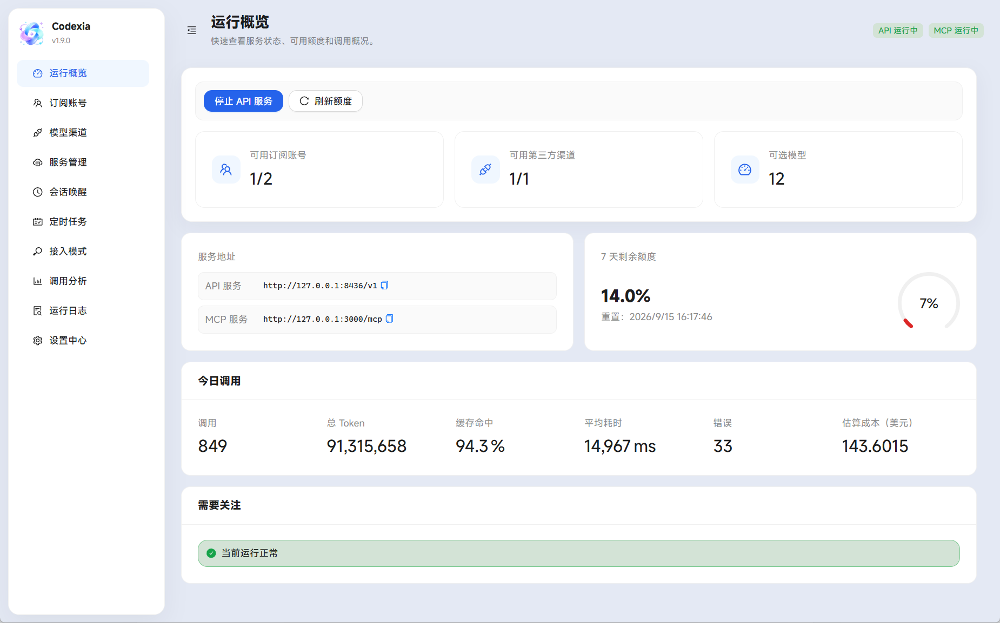

# Codexia

[English README](README.md)

Codexia 是一个 Windows 桌面应用，用于在 Codex 中集中使用 ChatGPT 订阅账号和第三方模型渠道。



## 功能

- 将多个 ChatGPT 订阅账号组成账号池，统一提供本地 API 服务。
- 接入 Responses API 第三方渠道，并在 Codex 中统一选择模型。
- 查看账号额度、重置卡、调用统计和预估成本。
- 在额度恢复后自动唤醒无人值守的长任务。
- 按时向已有会话发送消息，或启动新的 Codex 会话执行任务。
- 集中管理 Codex 接入配置和可选的 MCP 服务。

## 快速开始

1. 安装 Codex CLI，并确认 `codex` 命令可用。
2. 将 Windows 免安装包解压到可写目录，打开 `Codexia.exe`。从源码构建请参阅[开发](#开发)。
3. 添加 ChatGPT 订阅账号、模型渠道，或同时添加两者。
4. 打开“接入模式”并应用 API 模式。
5. 在“服务管理”中启动 API 服务。
6. 重新启动 Codex，加载已应用的配置并选择模型。

## 使用说明

### 订阅账号与模型渠道

订阅账号可以通过浏览器登录，也可以从 Codex 导入。Codexia 支持额度刷新、账号启停、重置卡使用和账号池路由。

第三方渠道需配置 API 地址、API Key 和模型目录，支持预览和调用测试；不同渠道的模型 ID 不能重复。除非渠道原生支持 Codex 压缩接口，通常保持“远程压缩适配”开启。

账号池模型目录在启动和手动刷新时更新，失败时使用缓存或本机 Codex 目录，也可通过 Codex Bundled 覆盖自定义目录。

账号池额度可在“运行概览”查看。按 Plus 基准折算默认关闭，可按套餐配置倍率；总剩余额度可超过 100%，概览圆环和客户端按总容量百分比展示。

### 接入模式与服务

API 模式汇集订阅和第三方模型；账号模式使用单个订阅账号，可通过 API 代理记录调用分析。

“服务管理”用于启动、停止或重启 API 服务和可选的 [`mcp-gateway-service`](https://github.com/jadchene/mcp-gateway)。MCP 服务首次启动前需要配置程序路径和监听地址。设置 `CODEX_HOME` 后，Codexia 会使用该目录中的 Codex 配置；未设置时使用当前用户的 `.codex`。

修改 API 或 MCP 服务设置后，可能需要重启对应服务。

其他 Responses API 客户端可使用服务地址加 `/v1` 作为 Base URL（默认为 `http://localhost:8436/v1`），并使用设置中的本地访问密钥。`GET /v1/models` 用于查询模型，`POST /v1/responses` 用于发送请求；具体可用能力取决于配置的订阅账号和渠道。

### 会话唤醒

登记会话 UUID、生效时段和最大尝试次数。账号池额度耗尽时，等待重置并刷新，确认恢复后发送继续消息；启用“恢复 Goal”会重新激活未完成的 Goal。停用、删除、到期或达到上限后停止等待。

### 定时任务

按计划向已有会话发送消息，或每次在指定工作目录启动新会话。支持可视化生成或手填五段 Cron；`0 22 * * *` 表示本机时间每天 22 点。同一任务不重叠执行，重启或休眠期间错过的时间点不补发。发送给已有会话的斜杠命令按普通文本处理。

这两项功能需保持 Codexia 运行，并确保本机 `codex` 可用。已有会话需保持运行并使用相同的 `CODEX_HOME`。

### 数据与调试

正式版数据位于程序旁的 `data/`，开发模式位于项目的 `data/`。升级时保留该目录，备份前先关闭应用。凭据使用 Windows 加密，复制到其他用户或电脑后可能无法使用。

数据库升级备份位于 `data/backups/`，超过 24 小时后在启动或清理数据时删除。

API 调试默认关闭，开启后会在 `data/logs/` 临时保存请求和响应正文，最长 10 分钟；关闭、到期或退出应用时删除。正文可能包含敏感信息，仅在排障时启用。

## 开发

需要 Node.js 24 或更高版本。

```bash
npm install
npm run dev
npm run verify
```

生成 Windows 免安装包：

```bash
npm run pack:unpacked
```

输出文件为 `release/win-unpacked/Codexia.exe`。该程序未进行代码签名，也不包含安装器。

## License

MIT. See [LICENSE](LICENSE).
